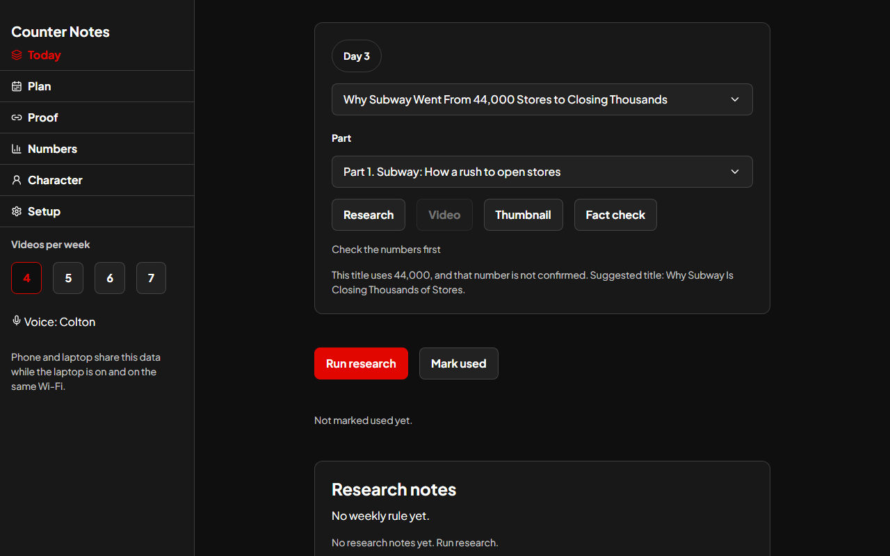
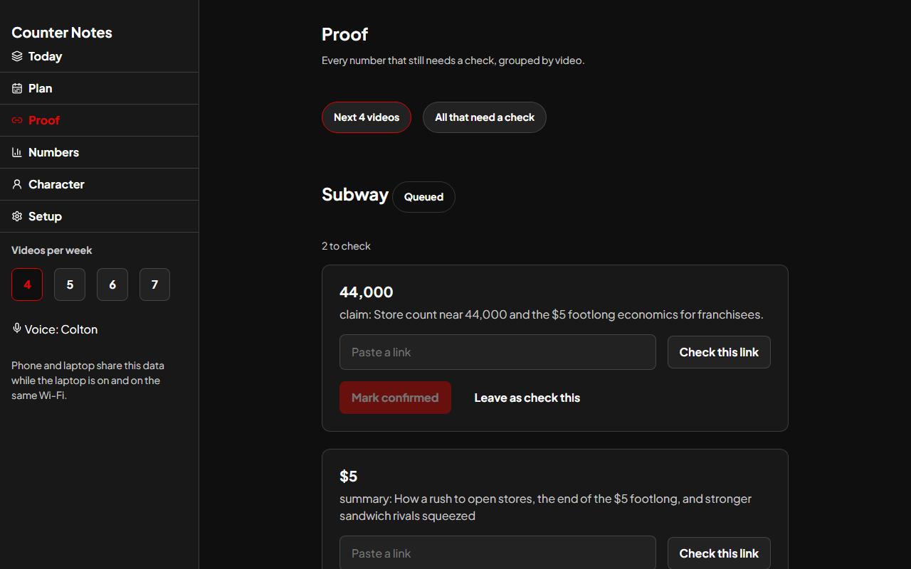
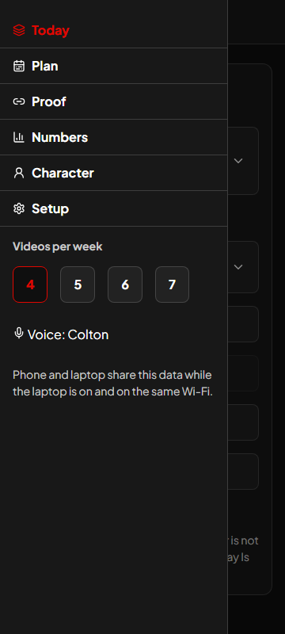

# Counter Notes Manager

A private website for one person who makes Counter Notes videos. You use it on your phone or on a computer. You pick the brand story, check the numbers, and copy a prompt. You still make the video and post it yourself.

## The problem

A business video is easy to get wrong. A store count, a price, or a year can sound true and still be unchecked. The prompts, the posting calendar, and the research notes end up in different notes apps. This site keeps that work in one place, and it refuses to call a number confirmed until you say so.

## Features

- Today: pick a video, copy the research, video, thumbnail, and fact-check prompts, and read the saved research lists.
- Plan: a 30-day calendar, 4 to 7 videos a week, and a weekly review you fill in by hand.
- Proof: one card per number. Paste a link, check it, then mark it confirmed or leave it as check this.
- Numbers: type subscribers and watch hours. The page estimates the monetization bars. It does not download them.
- Character: the logo, a sample thumbnail, and the illustrated host.
- Setup: the keywords and the channel ids the research uses.
- Research lists: a top 10, a same-topic list, and a "too small to count" list. Short videos stay out of the scores. You can ignore a top-10 row.
- One password for the site and the API. This computer asks for it too.

A plain-language tour is in [docs/how-it-works.md](docs/how-it-works.md). A shorter day-to-day guide is in [docs/learn-the-app.md](docs/learn-the-app.md). The status list in how-it-works says what is done, what is only partly built, and what is missing.

## Screenshots

Today, with the research lists under the prompt:



Proof, with one card per number:



The phone menu:



## How it fits together

```
phone or computer
        |
        v
React pages ----> Node API ----> local SQLite file
                     |               or Turso, when TURSO_DATABASE_URL is set
                     v
              Python research on port 8765
                     |
                     v
         YouTube Data API and other public pages
```

The pages, the database, and the daily job are described in [docs/architecture.md](docs/architecture.md).

## Tech stack

- React 19 and Vite 6 for the pages
- Node for the API, on the same Vite server
- SQLite locally, or Turso (libSQL) when `TURSO_DATABASE_URL` is set. The local file `data/counter-notes.sqlite` is not in git.
- Python, FastAPI, and Uvicorn for research
- Playwright for the layout checks

## Run it on your computer

You need Node 20 or newer, and Python 3.12 if you want research.

```bash
npm install
npm run dev
```

Open http://127.0.0.1:5174/

```bash
npm test
```

The research service is separate. From the `ml` folder:

```bash
python -m venv .venv
```

Windows:

```bash
.venv\Scripts\python -m pip install -r requirements.txt
.venv\Scripts\python -m uvicorn app:app --port 8765 --app-dir .
```

Mac or Linux:

```bash
.venv/bin/python -m pip install -r requirements.txt
.venv/bin/python -m uvicorn app:app --port 8765 --app-dir .
```

Run those last two commands from the `ml` folder. The research process does not start a job by itself. A research job can spend YouTube quota. It reads and writes through the Node API, so the site has to be running.

To open a demo database instead of your real one:

```bash
set COUNTER_NOTES_DEMO=1
npm run dev
```

On Mac or Linux, use `export COUNTER_NOTES_DEMO=1`. The demo file is `data/demo.sqlite`. Empty niche lists are filled from [data/sample-demo.json](data/sample-demo.json). Your real file is left alone.

`npm run research` in package.json uses the Windows virtualenv path. Use the `uvicorn` line above on Linux.

## Environment variable names

Put values in a file named `.env` in this folder. That file is gitignored. Do not commit it. The names are:

- `YOUTUBE_API_KEY`
- `FRED_API_KEY`
- `PEXELS_API_KEY`
- `COUNTER_NOTES_PASSCODE`
- `COUNTER_NOTES_SKIP_DAILY`
- `COUNTER_NOTES_EMBEDDINGS`
- `COUNTER_NOTES_DEMO`
- `COUNTER_NOTES_DB`
- `TURSO_DATABASE_URL`
- `TURSO_AUTH_TOKEN`
- `BACKUP_KEY`

The pages open after the password. YouTube research does nothing useful without `YOUTUBE_API_KEY`. FRED and Pexels are optional. `COUNTER_NOTES_EMBEDDINGS=1` turns on an extra model that is not installed by default. `BACKUP_KEY` is only for decrypting the daily backup.

## Hosting

On this computer the database is the local SQLite file. Set `TURSO_DATABASE_URL` and `TURSO_AUTH_TOKEN`, then run `npm run db:push`, to copy that file into Turso. Do not paste the token into the command.

The free host is a Render web service in Frankfurt, from `render.yaml` and the `Dockerfile`. The free instance sleeps, and it does not keep a database file, so the live database is Turso. The steps are in [docs/deploy.md](docs/deploy.md). The first visit after a sleep shows "Waking up, wait 1 minute."

Live demo: https://counter-notes-demo.onrender.com

The demo uses sample data, asks for no password, and does not save changes. The real site address stays out of this file.

## Limits

- The app does not upload videos to YouTube.
- It does not write the script for you. It copies prompts.
- It does not pull Studio analytics. You type those numbers.
- On this computer the database is a file. If the computer sleeps, the local site sleeps. A host uses Turso instead of that file. The free Render instance also sleeps after quiet time.
- The daily research job is a GitHub Action. It wakes the host, retries up to 3 times, and runs research once. Python does not keep a timer.
- YouTube quota is capped. The job stops before the last reserve is spent.
- Videos under 3 minutes are left out of the scores.
- A number stays "check this" until you mark it confirmed.
- The real site asks for a password on this computer and on a phone. If `COUNTER_NOTES_PASSCODE` is empty, the API refuses every request. Five wrong passwords from one place in 10 minutes block that place for 15 minutes. The block ends by itself.
- Demo mode (`COUNTER_NOTES_DEMO=1`) opens without a password, uses the sample channel, and refuses saves. It does not start research.

## Roadmap

- The Turso connection is in the app. A test row, a 16-table copy, matching counts, and one research run were measured against it. The backup download still writes a SQLite file. The daily Action encrypts its copy before upload. See [docs/backup.md](docs/backup.md).
- A 4-topic research run on this computer peaked at 99.7 MB for the site process and 270.9 MB for Python. Those peaks add to 370.6 MB, under the 512 MB free-host limit.
- The free host still sleeps. A paid instance that stays awake is not set up.
- The app still does not upload a video or write the script.

## Public sources

Research uses public pages and official APIs. It follows each site's robots.txt when it fetches a page, and it follows the YouTube API terms of service: https://developers.google.com/youtube/terms/api-services-terms-of-service

It does not scrape logged-in YouTube pages. It does not bypass a block.

## License

[MIT](LICENSE). See [CONTRIBUTING.md](CONTRIBUTING.md) before you send a change.
